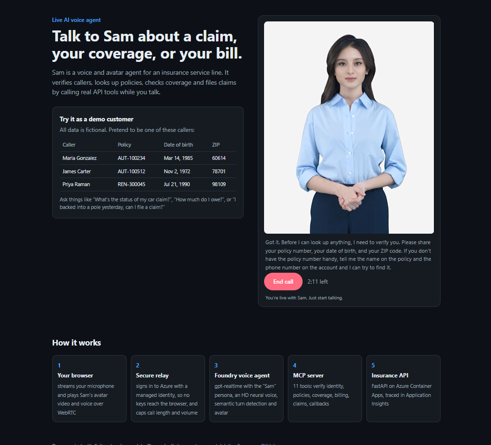

# Contoso Insurance API + MCP Server

A demo insurance **policy servicing and claims API** built with **FastAPI** and **FastMCP**. The same
business logic is exposed two ways:

- **REST API** at `/api/...` with Swagger UI at `/docs`
- **MCP server** (Streamable HTTP) at `/mcp`, ready to plug into a **Microsoft Foundry voice agent**
  as an MCP tool
- **Public "Talk to Sam" page** at `/`, where anyone can talk to that voice agent, avatar included,
  from the browser



Every response includes a short `summary` written to be spoken aloud, which keeps realtime voice
agents (e.g. `gpt-realtime`) fast and natural.

```
Browser (/) ── mic over WebSocket ──▶ /voice/ws relay (managed identity, call limits)
   ▲                                          │
   └── avatar video + voice over WebRTC ──── Foundry voice agent (gpt-realtime, HD voice, avatar)
                                              │  MCP over HTTPS (/mcp, x-api-key)
                                              ▼
                              Azure Container Apps: FastAPI + FastMCP
                                              │
                                InsuranceService ──▶ in-memory seed data (swap for Cosmos DB / SQL)
```

The relay, MCP server and REST API are one container app; Application Insights traces all three.

## MCP tools

| Tool | What it does |
|---|---|
| `find_customer` | Look up a customer by name, phone, email or policy number (returns masked PII) |
| `verify_customer_identity` | Verify the caller with policy number + date of birth + ZIP |
| `list_customer_policies` | All policies for a verified customer |
| `get_policy_details` | Status, term, vehicles/property, coverages, limits, deductibles, exclusions |
| `check_coverage` | "Am I covered for…?" Maps a plain-language incident to the coverage, deductible and limit |
| `get_billing_summary` | Amount due, due date, past-due balance, autopay, payment options |
| `list_claims` | Claims on a policy with status |
| `get_claim_status` | Claim status, adjuster, estimate, payments, next step, timeline |
| `file_claim` | First notice of loss; returns claim number, adjuster, next steps |
| `add_claim_note` | Add info (e.g. police report number) to a claim |
| `request_callback` | Schedule a licensed human agent callback |

## REST endpoints

| Method | Path |
|---|---|
| GET | `/health` |
| GET | `/api/customers/search?full_name=&phone=&email=&policy_number=` |
| POST | `/api/customers/verify` |
| GET | `/api/customers/{customer_id}/policies` |
| GET | `/api/policies/{policy_number}` |
| GET | `/api/policies/{policy_number}/coverage-check?incident_type=` |
| GET | `/api/policies/{policy_number}/billing` |
| GET | `/api/policies/{policy_number}/claims` |
| GET | `/api/claims/{claim_number}` |
| POST | `/api/claims` |
| POST | `/api/claims/{claim_number}/notes` |
| POST | `/api/callbacks` |

## Run locally

```bash
python -m venv .venv && source .venv/bin/activate   # Windows: .venv\Scripts\activate
pip install -r requirements-dev.txt
pytest -q
uvicorn app.main:app --reload
```

- Swagger: http://localhost:8000/docs
- MCP endpoint: http://localhost:8000/mcp

Test the MCP server with the MCP Inspector:

```bash
npx @modelcontextprotocol/inspector
# Transport: Streamable HTTP, URL: http://localhost:8000/mcp
```

Optional: `export API_KEY=some-long-random-value` to require an `x-api-key` header on `/api` and `/mcp`.

Or with Docker:

```bash
docker build -t insurance-mcp-api .
docker run -p 8000:8000 -e API_KEY=change-me insurance-mcp-api
```

## Deploy to Azure Container Apps

Prerequisites: [Azure Developer CLI (azd)](https://aka.ms/azd-install) and an Azure subscription.
No local Docker needed — azd builds the image remotely in Azure Container Registry.

```bash
azd auth login
azd env new insurance-mcp            # any environment name
azd env set MCP_API_KEY "$(openssl rand -hex 24)"
# Windows PowerShell: azd env set MCP_API_KEY ([guid]::NewGuid().ToString("N") + [guid]::NewGuid().ToString("N"))
azd up                               # pick subscription + region
azd env get-value MCP_ENDPOINT       # e.g. https://ca-insurance-xxxx.<region>.azurecontainerapps.io/mcp
```

Telemetry goes to the Application Insights resource `appi-<token>` (`azd env get-value APPLICATIONINSIGHTS_NAME`).
Requests and dependencies are collected automatically, and each MCP tool call appears as an
`mcp.tool <name>` span, marked failed when the tool returns an error. Locally, telemetry is off unless
`APPLICATIONINSIGHTS_CONNECTION_STRING` is set.

### Public voice demo page

The app's home page (`/`) is a public "Talk to Sam" page: visitors talk to your Foundry voice agent,
with its avatar, straight from the browser. The browser streams microphone audio to `/voice/ws`, and
the app relays it to the Foundry voice agent's realtime endpoint using its managed identity, so no Azure key or
token ever reaches the visitor. The relay only forwards audio, interruptions and the avatar handshake;
visitors can't change the agent's instructions or tools.

It needs a Foundry **voice agent** (`kind: voice`), the kind with a voice, avatar and greeting
configured in Foundry. The relay connects to that agent's realtime route,
`/api/projects/<project>/agents/<agent>/endpoint/protocols/voice`. Point it at your agent, then run
`azd up` again:

```bash
azd env set FOUNDRY_RESOURCE_NAME  <foundry-resource>     # e.g. arul1
azd env set FOUNDRY_RESOURCE_GROUP <its-resource-group>   # e.g. rg_aml
azd env set FOUNDRY_PROJECT_NAME   <project>              # e.g. proj-default
azd env set VOICE_AGENT_NAME       <agent-name>
azd up
azd env get-value VOICE_DEMO_URL
```

This grants the app's identity **Foundry User** (formerly Azure AI User) and **Cognitive Services User** on the Foundry
resource, so the account running `azd up` needs permission to assign roles there (Owner or User
Access Administrator).

Because the page is public, every call is capped. Defaults, overridable as container app env vars:

| Variable | Default | Meaning |
|---|---|---|
| `VOICE_MAX_SESSION_SECONDS` | 180 | Calls end automatically after this long |
| `VOICE_MAX_CONCURRENT_SESSIONS` | 2 | Simultaneous callers |
| `VOICE_DAILY_SESSION_LIMIT` | 40 | Calls per UTC day, across all visitors |
| `VOICE_HOURLY_SESSIONS_PER_VISITOR` | 4 | Calls per IP address per hour |
| `VOICE_ALLOWED_ORIGINS` | (any) | Comma-separated origins allowed to open the WebSocket |

The voice, avatar, greeting and instructions all come from the agent's configuration in Foundry;
change them there. If the avatar can't connect (for example on a network that blocks WebRTC), the call
continues with voice only.

After code changes, `azd deploy` updates just the app, which is faster than `azd up`.

**Troubleshooting.** The page logs every non-audio event from the agent to the browser console as
`[voice] <event type> <json>`, and the relay records errors and empty responses in Application Insights.
- *Sam greets you but never hears you:* turn off **Echo cancellation** in the agent's Advanced settings
  (see [docs/foundry-agent-instructions.md](docs/foundry-agent-instructions.md#settings)). The relay also
  asks the service to switch it to a server reference for each call, and the page sends the two-channel
  audio that mode expects if the setting stays on.
- *Every response is empty (0 tokens):* the agent isn't a voice agent, or the relay is pointed at the wrong
  project or agent name.

### Continuous deployment from GitHub

```bash
azd pipeline config                  # sets up OIDC + repo variables for .github/workflows/azure-dev.yml
gh secret set MCP_API_KEY --body "$(azd env get-value MCP_API_KEY)"
```

Every push to `main` then runs tests (`ci.yml`) and redeploys (`azure-dev.yml`).

## Connect it to the Foundry agent

1. In Microsoft Foundry, open the agent → **Tools** → **Add a MCP tool** (custom / remote MCP server).
2. **Name**: `contoso-insurance`; **Remote MCP server endpoint**: the `MCP_ENDPOINT` value from above.
3. **Authentication**: key-based, header name `x-api-key`, value = your `MCP_API_KEY`.
4. **Approval**: set to *never require approval* for the demo, so the voice conversation isn't interrupted.
5. Paste the instructions and greeting from [docs/foundry-agent-instructions.md](docs/foundry-agent-instructions.md),
   apply the settings listed there, then **Save** and try it in the voice playground using the demo callers.

## Project layout

```
app/
  main.py          FastAPI app, mounts MCP at /mcp, API-key middleware
  mcp_server.py    FastMCP tool definitions
  api.py           REST routes
  services.py      Business logic (shared by REST + MCP)
  repository.py    In-memory store loaded from data/seed.json
  security.py      Optional x-api-key check (pure ASGI, streaming-safe)
  telemetry.py     Application Insights setup and per-tool MCP spans
  voice.py         Public voice demo: relay to the Foundry voice agent, with call limits
  static/          "Talk to Sam" page (HTML, CSS, mic capture, WebRTC avatar)
  data/seed.json   Fictional customers, policies, billing, claims
infra/             Bicep for Container Apps, ACR, Log Analytics, Application Insights, managed identity
docs/              Foundry agent instructions and demo script
tests/             pytest: service, REST, MCP, telemetry and voice relay tests
```

## Notes

- All data is fictional. Claims and callbacks you create are stored in memory and reset on restart;
  the app runs as at most one replica for that reason. It scales to zero when idle, so the first
  visitor (or the agent's first tool call) after a quiet spell waits a few seconds for it to start,
  and in-memory data and call counts reset then. Replace `InMemoryRepository` with a Cosmos DB or
  SQL implementation for anything beyond a demo.
- Identity verification is a demo pattern (DOB + ZIP), not production-grade authentication.
- The voice page is public and every call costs money (realtime model, neural voice and avatar minutes).
  Keep the call limits in place, and tighten `VOICE_DAILY_SESSION_LIMIT` if you share the link widely.

## License

MIT
